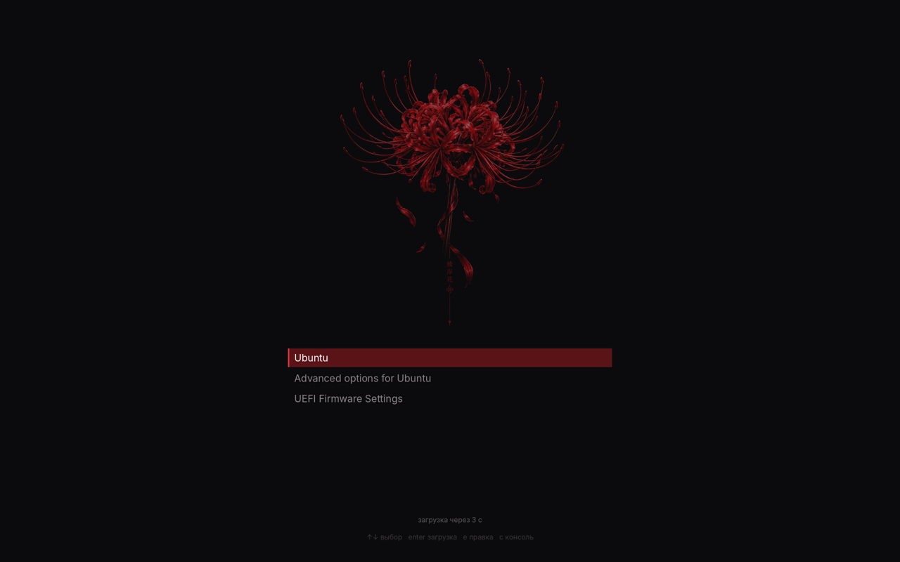

# 彼岸花 Higanbana

Тёмная тема для KDE Plasma 6 вокруг живых обоев с красной паучьей лилией: почти чёрный фон, акцент `#c4161c`, тонкие шрифты, размытие и скругления. Оформление одно на всём пути, от меню GRUB до терминала и IDE.



## Что внутри

| Слой | Что настроено |
|---|---|
| Загрузка | GRUB (меню с лилией), Plymouth (проявление лилии, полоска прогресса, ввод пароля диска) |
| Вход и блокировка | SDDM Breeze с кадром лилии, экран блокировки, курсор Bibata Modern Ice |
| Рабочий стол | живые обои «Emptiness» (пересобраны из сцены Wallpaper Engine, 4K и 2560×1600), часы 土曜日 |
| Plasma | цветовая схема Higanbana, Breeze Dark, Papirus-Dark с красными папками, шрифты Inter / JetBrains Mono |
| Окна | Kvantum с прозрачностью и размытием, скруглённые углы, тайлинг Krohnkite с отступами, автоскрывающиеся док и верхняя панель |
| Терминал | Konsole (полупрозрачный), starship, fastfetch, eza, bat, btop, cava, tmux, файловый менеджер yazi |
| Приложения | IntelliJ (плагин темы), Telegram, Obsidian (CSS-сниппет), Firefox (userChrome) |

## Установка на новую систему

```bash
git clone https://github.com/dyra4eck/higanbana-theme ~/higanbana-theme
cd ~/higanbana-theme && ./install.sh
```

Запускать нужно из сессии Plasma (Kubuntu/Ubuntu 26.04 или новее), а потом перезагрузиться.

- Если в `home/` и `system/` есть снимок, сделанный `sync.sh`, ставится именно он: точная копия рабочей системы со всеми ручными правками.
- Если снимка нет (или запустить с `./install.sh --steps`), тема собирается с нуля скриптами из `steps/`.

После установки руками делается немного:
- **Telegram:** открыть `~/Pictures/Higanbana.tdesktop-theme` и нажать «Keep changes».
- **IntelliJ:** Settings → Plugins → ⚙ → Install Plugin from Disk → `assets/intellij/higanbana-intellij-theme.jar`.

## Обновление снимка

После любых правок темы на рабочей машине:

```bash
cd ~/higanbana-theme && ./sync.sh && git add -A && git commit -m "sync" && git push
```

`sync.sh` копирует в `home/` и `system/` конфиги Plasma, KWin, Krohnkite и Kvantum, цвета, курсор, шрифт, виджеты, KWin-скрипты, плагин обоев, конфиги терминала, блок из `.bashrc`, а также темы SDDM, GRUB и Plymouth. Секретов там нет. Если меняется имя пользователя, `install.sh` сам заменяет старый путь домашнего каталога на новый.

## Структура

```
install.sh          установка (снимок или шаги)
sync.sh             снимок текущей системы → home/, system/
steps/              пошаговая установка с нуля
  01-plasma.sh                 цвета, шрифты, иконки, KWin-эффекты, Konsole
  02-kvantum-gtk.sh            Kvantum, красные папки, GTK
  03-panels.sh                 док снизу + верхняя строка
  04-terminal-cursor-lock.sh   starship, fastfetch, Nerd Font, курсор, экран блокировки
  05-tiling-sddm-tools.sh      Krohnkite, скругления, SDDM, btop/cava/tmux
  06-boot-apps-widget.sh       Plymouth, GRUB, Telegram/Obsidian/Firefox, часы
  07-yazi.sh                   yazi: тема, плагины, функция y
assets/             обои, Plymouth, GRUB, тема Telegram, сниппеты, плагин IntelliJ, виджет
home/, system/      снимок (заполняется sync.sh)
```

## yazi

Терминальный файловый менеджер запускается командой `y`. После выхода терминал остаётся в той папке, где ты закрыл yazi.

| Клавиши | Действие |
|---|---|
| `F1` / `~` | все горячие клавиши |
| `h j k l`, `Enter` | навигация, открыть |
| `Space`, `y` / `x` / `p`, `d` | выделить, копировать / вырезать / вставить, в корзину |
| `s` / `S` | поиск по имени (fd) / по содержимому (rg) |
| `z` / `Z` | переход через fzf / zoxide |
| `T` | развернуть предпросмотр |
| `Ctrl+o` | показать файл в Dolphin, оттуда удобно перетаскивать |

Конфиг лежит в `assets/yazi/` и ставится в `~/.config/yazi/`. Плагины `git`, `full-border`, `smart-enter` и `toggle-pane` ставятся через `ya pkg`.

## Откат

- **Конфиги пользователя:** `cp ~/.config/pre-higanbana-<дата>/* ~/.config/`, эту команду `install.sh` выводит в конце работы.
- **GRUB:** `sudo rm /etc/default/grub.d/99-higanbana.cfg && sudo update-grub`.
- **Plymouth:** `sudo update-alternatives --config default.plymouth && sudo update-initramfs -u`.
- **Экран входа обратно на gdm3:** `sudo systemctl disable sddm && sudo systemctl enable --force gdm3`.

## Известные нюансы

- **Скругления углов** — сторонний эффект KWin, его пересобирают после каждого обновления KWin. Автозапуск `test-install-kde-rounded-corners.desktop` делает это сам.
- **Krohnkite:** тайловые окна должны быть на обычном слое (`tiledWindowsLayer=1`), иначе окно в фокусе прячется под плавающими. Это уже учтено.
- **Экран входа:** greeter SDDM работает на X11, на Wayland мигает экранная клавиатура. Плагин `qt6-virtualkeyboard-plugin` удаляется.
- **Firefox из snap** не видит GTK-тему Plasma, поэтому меняется только форма через userChrome, цвета остаются стандартными тёмными.
